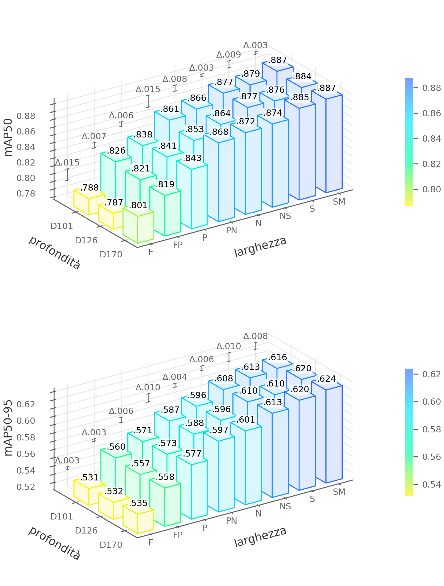
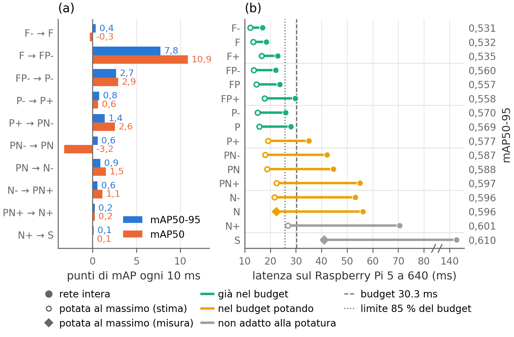

# Stato lavori al 16 novembre 2026

## Sintesi

Il lavoro di base è completo: ho addestrato sul dataset sviluppato in precedenza tutte le taglie del modello e le ho misurate sul Raspberry
Pi 5, in fp16 e in int8 utilizzando diversi backend di inferenza.

- Risultati di base: 24 varianti di YOLO26 (8 larghezze x 3 profondità), addestrate da zero con la
  stessa ricetta e misurate sul Pi a 640x640. Nel budget di 30 fps il modello migliore è P-: 0,570 di mAP50-95 a
  26 ms. Le varianti del modello utilizzate espandono le 4 standard fornite dalla libreria di default.
- Quantizzazione int8:ul Pi l'int8 non è più veloce dell'fp16 in nessuna variante provata. La motivazione è
  nelle misure di latenza riportate sotto. Tutto il resto delle considerazioni è riferito a fp16.
- Lavoro extra sul pruning (in corso): Con i risultati di base in mano, sto provando a ottenere un modello migliore potando un modello più grande. Ho costruito uno stimatore della latenza specifico per l'hardware target (errore di previsione del 3,5% al 99° percentile) e lo sto usando ora per la potatura. I risultati arriveranno a ricerca completata.
- Lavoro extra su ottimizzazione del deploy. Ho provato tre strade per abbassare la latenza senza toccare il
  modello: un ulteriore backend (NCNN), il tiling dei primi strati e l'overclock della CPU. NCNN aiuta solo il modello
  P e il tiling non porta niente di utile; l'overclock è l'unica strada che accelera entrambi i modelli.

## Condizioni sperimentali

Queste sono le condizioni comuni a tutti gli esperimenti del report.

- **Dispositivo.** Raspberry Pi 5, CPU a 4 core, governor performance, backend OpenVINO.
  > Nota: ho fatto anche delle misure variando il numero di core e la frequenza del processore. I compromessi fra accuratezza e latenza peggiorano troppo, quindi mi sono messo nella condizione in cui l'intero hw è dedicato all'inferenza.
- **Budget.** 30 fps sono 33 ms dal fotogramma ai box finali. Ho misurato a parte pre e post-elaborazione e li ho
  sottratti: al modello restano 30,3 ms a 640x640.
- **Modello.** YOLO26 con testa one-to-one (senza NMS), 4 classi. Senza NMS il post-processing ha costo fisso, quindi
  la latenza non dipende dai pesi.
- **Training.** Una sola ricetta per tutti: da zero, 640x640, 300 epoche, ottimizzatore MuSGD (lr 0,01), augmentation
  di YOLO26 più un degrado simulato della camera (blur, rumore, JPEG).
- **Metrica.** mAP50-95 sul validation set, oggetti di almeno 8 px. Sotto 1 punto di differenza considero due modelli
  pari, e vince il più veloce.
- **Misura di latenza.** Misurata sul dispositivo, sul modello esportato, mediana di 3 passate. Il rumore tra due misure
  della stessa rete è circa 1%.

## Parte 1: Risultati di base

### Le taglie del modello

Le 24 varianti di YOLO26 sono state ottenute manipolando questi due parametri architetturali:

- Larghezza: moltiplicatore dei canali, da 0,0625 a 0,75. Le taglie standard sono 0,25 (nano) e 0,5 (small). Le
  altre le ho costruite apposta, anche sotto il nano (0,125 "pico", 0,0625 "femto").
- Profondità: numero di strati convoluzionali, 101, 126 (standard) o 170. Il moltiplicatore di profondità di
  Ultralytics non riduce YOLO26 sotto lo standard, quindi la variante corta è costruita con un tipo di blocco più
  semplice.

Sigle: lettera per la larghezza e segno per la profondità (- 101 strati, nessun segno 126, + 170). Per esempio P-
è larghezza 0,125 con 101 strati.

### Accuratezza

*mAP50 (sopra) e mAP50-95 (sotto) sul validation set per le 24 varianti. I segmenti con Δ indicano la differenza tra
la profondità migliore e la peggiore a pari larghezza.*

mAP50-95 sul validation set (un seed; per P standard ho 5 seed, tra 0,563 e 0,573, e riporto il migliore):

| Larghezza | 101 strati (-) | 126 strati | 170 strati (+) |
|---|---|---|---|
| F (0,0625) | 0,531 | 0,532 | 0,535 |
| FP (0,09375) | 0,560 | 0,557 | 0,558 |
| P (0,125) | 0,571 | 0,573 | 0,577 |
| PN (0,1875) | 0,587 | 0,588 | 0,597 |
| N (0,25) | 0,596 | 0,596 | 0,601 |
| NS (0,375) | 0,608 | 0,610 | 0,613 |
| S (0,5) | 0,613 | 0,610 | 0,620 |
| SM (0,75) | 0,616 | 0,620 | 0,624 |

### Latenza sul Raspberry Pi 5

Latenza in millisecondi a 640x640, fp16. In grassetto i modelli dentro il budget di 30,3 ms.

| Larghezza | 101 strati (-) | 126 strati | 170 strati (+) |
|---|---|---|---|
| F (0,0625) | **16,7** | **18,1** | **22,8** |
| FP (0,09375) | **21,8** | **23,6** | **29,4** |
| P (0,125) | **25,7** | **27,7** | 34,7 |
| PN (0,1875) | 41,7 | 44,5 | 54,8 |
| N (0,25) | 53,4 | 56,5 | 70,9 |
| NS (0,375) | 91,6 | 96,6 | 120,7 |
| S (0,5) | 136,7 | 143,9 | 178,6 |
| SM (0,75) | 228,8 | 242,5 | 303,3 |

### Osservazioni

- Nel budget il migliore è P-: 0,570 a 26 ms. È il modello di riferimento per il Pi. P standard è pari in
  accuratezza ma più lento di 2 ms.
- Conta la larghezza più della profondità. Raddoppiare la larghezza da P a N vale +0,025. Passare da 101 a 170
  strati vale +0,003-0,010 e costa il 30-35% di latenza.
- Dalla NS in su tutta la griglia guadagna circa 1 punto. Con 4 classi il dataset non
  premia i modelli grandi.
- I modelli più grandi arrivano a 0,62, cioè 5 punti sopra P-, ma
  costano da 2 a 10 volte il budget. Da qui nasce la parte 2.

### fp16 contro int8

Ho misurato la latenza sul Pi nelle due precisioni. L'int8 non dà nessun vantaggio, quindi non lo uso.

| Modello | Variante | Latenza Pi (ms) | mAP50-95 |
|---|---|---|---|
| P- | OpenVINO fp16 | 25,8 | 0,570 |
| P- | onnxruntime int8, parti sensibili in float | 57,7 | 0,552 |
| P- | onnxruntime int8, quasi tutto quantizzato | 26,5 | 0,560 |
| P- | OpenVINO int8 (NNCF) | 37,1 | 0,574 |
| N- | OpenVINO fp16 | 53,3 | 0,594 |
| N- | onnxruntime int8, parti sensibili in float | fallita | n.d. |
| N- | onnxruntime int8, quasi tutto quantizzato | fallita | n.d. |
| N- | OpenVINO int8 (NNCF) | 76,2 | 0,595 |

Le misure sono fatte sui modelli della griglia (P- e N-, dataset attuale), con calibrazione su 511 immagini.

Le due misure sono fallite perché durante la misura con onnxruntime il Pi si è riavviato da solo, in entrambi i casi circa un
minuto dopo l'avvio. La causa non è accertata. Non le ho ripetute, perché il confronto su P- e le due misure OpenVINO
su N- bastano per la decisione.

I motivi, ricavati dal profilo per strato (fatto in una prova precedente, sulle taglie P e N addestrate sul dataset
precedente), sono tre:

- Il Cortex-A76 del Pi calcola in fp16 in modo nativo, mentre non ha le istruzioni int8 veloci.
- OpenVINO su ARM non esegue davvero le convoluzioni in int8. Con onnxruntime la funzione di
  attivazione SiLU, circa un terzo del tempo, costa uguale in int8 e in fp16.
- Alla fine della testa, coordinate dei box e punteggi stanno nello stesso tensore: con una
  sola scala di quantizzazione i punteggi si azzerano. Quella parte va lasciata in float, e ogni nodo in float toglie
  il poco guadagno dell'int8.

Nessuna variante int8 è più veloce dell'fp16. Nel caso migliore (onnxruntime, quasi tutto quantizzato) l'int8 è più
lento del 3% e perde 1 punto di mAP. Con OpenVINO l'int8 mantiene la mAP ma è più lento del 43%. È un'ottimizzazione
da escludere su questo dispositivo.

## Parte 2 (Extra): potatura guidata dalla latenza

Con i risultati di base completi, sto provando ad andare oltre, prendendo un modello più grande e accurato e potandolo
fino a farlo rientrare nel budget. L'obiettivo è superare P- alla stessa latenza.

*(a) Punti di mAP guadagnati ogni 10 ms passando da un modello al successivo. (b) Per ogni modello: latenza intera
(punto pieno) e latenza con la potatura al massimo (punto vuoto). I modelli in arancione sono fuori budget da interi,
ma ci rientrano potando: sono i candidati per questa parte.*

### Stimatore di latenza (completato)

Per potare verso un target in millisecondi serve predire la latenza di una rete senza misurarla ogni volta sul Pi. Lo
stimatore che ho costruito sbaglia del 3,5% al 99° percentile. Contare le operazioni (MAC), il metodo classico, sbaglia
del 31%.

Sul Pi la latenza di una convoluzione non è lineare nei canali: ha gradini ogni 32 canali di uscita, quindi una
formula non basta. La stima è in due parti:

1. Una tabella delle latenze. Misurato sul Pi ogni tipo di strato isolato, per ogni coppia di canali (ingresso,
   uscita) a passo 2.
2. La latenza della rete è una parte fissa per architettura più la somma delle voci della
   tabella, ognuna con un coefficiente per tipo di strato:

   `L_rete = C_arch + Σ_f a_f · Σ_{s in f} LUT_f(c_in, c_out)`

Ho stimato i coefficienti su 765 reti potate a caso di 15 architetture. La verifica è su
architetture tenute fuori dal fit.

| Stimatore | Errore al 99° percentile |
|---|---|
| Conteggio delle operazioni (MAC) | 31,4% |
| Somma della tabella senza coefficienti | 12,9% |
| Tabella + fit | 3,5% |

L'errore mediano è 0,9%, pari al rumore tra due misure della stessa rete.

### Ricerca dell'architettura potata

Uso PIT (libreria PLiNIO) con maschere sui canali e il regolarizzatore DUCCIO: la penalità è attiva solo finché la
latenza stimata supera il target. Il costo è lo stimatore, quindi il target si dà in millisecondi.

L'architettura trovata è poi riaddestrata da zero per 300 epoche. Latenza e mAP finali sono misurate sul Pi, così il confronto con la
griglia è alla pari.

### Stato

La ricerca funziona, perché le reti potate escono entro il target senza nessuna misura sul Pi durante la ricerca. Sto
mettendo a punto gli iperparametri (ottimizzatore delle maschere, durata della ricerca, target, modello di partenza),
cambiando una cosa sola per test. Riporterò i numeri quando la messa a punto sarà chiusa e le reti migliori confermate
con più seed.

C'è un limite: vicino al budget la curva della griglia è piatta (da 26 a 35 ms la mAP sale di 0,007), quindi il
margine da conquistare è piccolo per qualsiasi metodo.

## Parte 3 (Extra): ottimizzazione del deploy sul Pi

### Secondo backend: NCNN

NCNN è un motore di inferenza pensato per CPU ARM. Ho aggiunto il backend alla pipeline e l'ho confrontato con
OpenVINO, rimisurato nella stessa sessione. Latenza media di 3 passate, mAP sul validation set calcolata sul Pi. L'fp32 è
escluso a priori.

| Modello | Backend | Latenza Pi (ms) | Δ latenza | mAP50-95 |
|---|---|---|---|---|
| P | OpenVINO fp16 | 27,7 | rif. | 0,569 |
| P | **NCNN fp16** | **25,4** | **-8,4%** | 0,575 |
| P | NCNN int8 | 30,6 | +10,3% | 0,536 |
| N | OpenVINO fp16 | 56,7 | rif. | 0,593 |
| N | NCNN fp16 | 57,7 | +1,7% | 0,599 |
| N | NCNN int8 | 63,3 | +11,5% | 0,566 |

NCNN conviene solo sul modello piccolo, mentre su N è pari a OpenVINO. Anche con NCNN l'int8 resta escluso, perché è
più lento dell'fp16 e meno accurato, come già visto nella parte 1. La mAP dei due backend non è confrontabile alla
pari: l'export di NCNN perde la testa one-to-one e passa per l'NMS, e la piccola differenza di mAP dipende da questo e
non dal backend. In deploy servirebbe quindi un NMS fuori dal grafo, e i guadagni in latenza vanno letti tenendone
conto.

### Tiling dei primi strati

L'idea è dividere l'immagine in tile e far elaborare ogni tile a un core, con gli stessi pesi, invece di lasciare che
OpenVINO divida ogni strato fra i 4 core. Ho provato i primi 1-4 strati di P e N, con 4, 8 e 16 tile. Le tile si
sovrappongono ai bordi quanto basta perché il risultato ricucito sia identico a quello senza tiling.

| Strati con tiling | Halo | P: miglior speedup | N: miglior speedup |
|---|---|---|---|
| Solo il primo | 2 px | 1,14x (-0,4 ms) | 1,09x (-0,4 ms) |
| Primi 2 | 4 px | 1,05x | 0,99x |
| Primi 3 | 12 px | 0,91x | 0,91x |
| Primi 4 | 16 px | 0,86x | 0,87x |

OpenVINO parallelizza già bene, perché divide ogni strato fra i 4 core con un'efficienza dell'80-90%, e il tiling
può recuperare solo quello che manca. L'halo però cresce con la profondità: dal terzo strato i pixel ricalcolati
costano più di quanto si guadagna, e la perdita aumenta con il numero di tile. Sul primo strato il guadagno c'è, ma
sulla rete intera è trascurabile anche prima di contare il taglio e la ricucitura delle tile, quindi escludo il tiling.

### Overclock della CPU

OpenVINO fp16, 4 core, governor performance. Il Pi regge fino a 3,0 GHz senza throttling.

| CPU (GHz) | Latenza P (ms) | Δ P | Latenza N (ms) | Δ N |
|---|---|---|---|---|
| 2,4 (di serie) | 27,6 | rif. | 56,6 | rif. |
| 2,6 | 25,9 | -6,2% | 53,3 | -5,9% |
| 2,8 | 24,6 | -10,8% | 50,3 | -11,2% |
| 2,9 | 23,7 | -14,1% | 48,9 | -13,7% |
| 3,0 | 23,3 | -15,5% | 47,6 | -16,0% |

La latenza scende meno del clock, perché circa un terzo del tempo non scala con la CPU e probabilmente è tempo di
accesso alla memoria. La frequenza della GPU invece non conta: a 3,0 GHz, con la GPU a 1000 MHz invece che di serie,
la latenza cambia meno dell'1%, dato che l'inferenza gira tutta sulla CPU. Questi numeri sono fuori dalle condizioni
della parte 1, quindi servono a capire quanto margine dà l'hardware e non entrano nel confronto fra modelli.