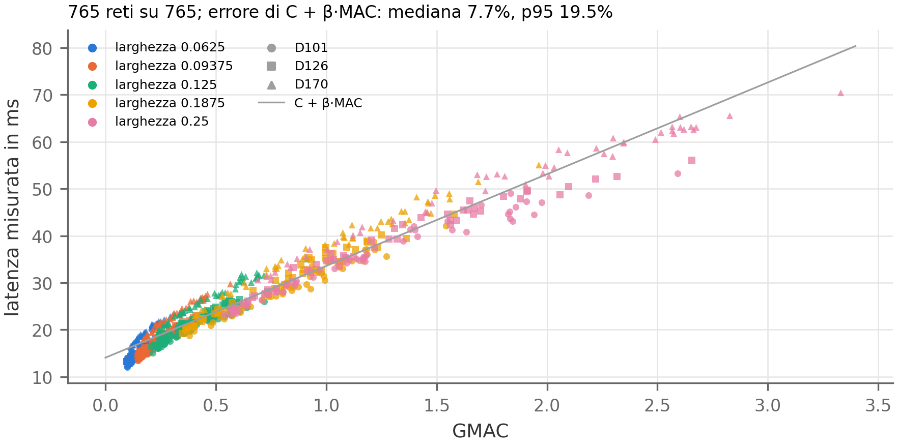
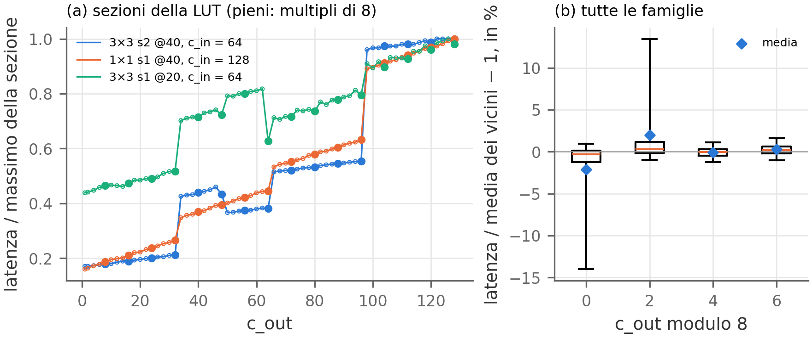
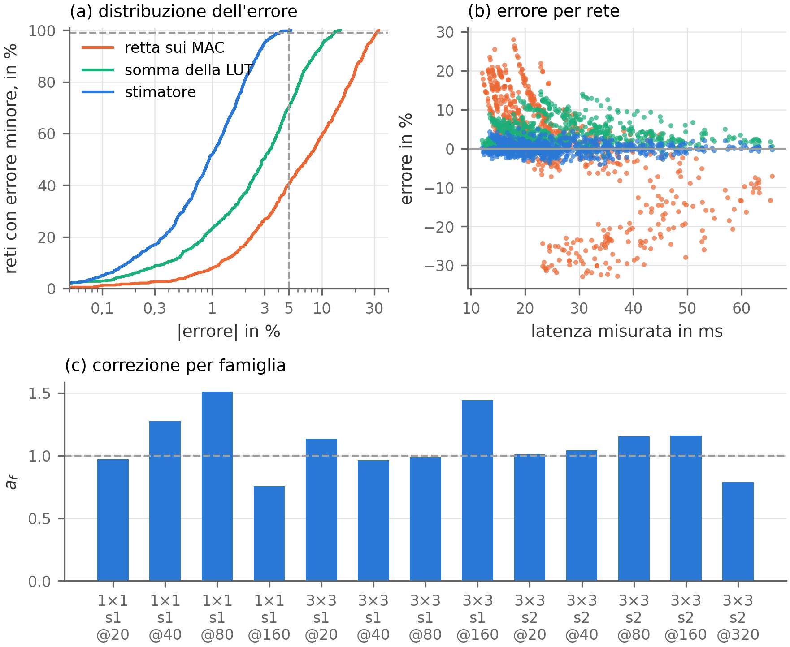

# Come stimare la latenza di uno YOLO senza eseguirlo ***

> **In breve.** I MAC non predicono bene la latenza sul Pi. Lo stimatore basato su una tabella di latenze misurate
> (LUT) sì. Su 750 reti potate di 15 architetture, ognuna stimata senza averla vista nel fit, l'errore al 99°
> percentile è **4,1% con lo stimatore** contro **31,4% con i MAC**. L'obiettivo era il 5%.

## 1. Perché serve

La potatura con PIT toglie canali alle convoluzioni di YOLO26 finché la rete non rispetta un obiettivo di costo.
Oggi l'obiettivo è espresso in operazioni (MAC). Sul dispositivo però conta la **latenza**, e le due grandezze non
sono proporzionali. Sulla LUT completa un fit lineare `a + b·MAC`, adattato famiglia per famiglia, sbaglia in mediana
dall'8 al 25% a seconda della famiglia, e al 95° percentile fra il 34 e il 78%. Sbaglia di più sulle mappe grandi:
per le 1×1 a 80×80 e a 160×160 l'errore mediano è del 19 e del 25%. Due reti con gli stessi MAC possono quindi avere
latenze diverse, e una potatura guidata dai MAC toglie canali dove costano poco in tempo.



*Figura 1. Latenza misurata sul Pi contro MAC delle reti B4-R (potature casuali di 15 architetture), con la retta
C + β·MAC adattata su tutte. Colore: larghezza; simbolo: profondità. A parità di MAC le reti più profonde (D170)
sono più lente e le meno profonde (D101) più veloci: i MAC non vedono quanti strati ci sono. Con una sola retta
l'errore è del 7,7% in mediana e del 26,3% al p99; anche con una costante diversa per ogni architettura (sezione 7)
resta del 7,2% e del 31,4%.*

## 2. Obiettivo

Serve una funzione **differenziabile** che, dati i canali di ingresso e di uscita di ogni convoluzione potabile,
stimi la latenza sul Raspberry Pi 5 (OpenVINO fp16, 4 core, 2,4 GHz, ingresso 640×640) di una rete derivata da
YOLO26. Il requisito è un **errore relativo entro il 5% al 99° percentile** sulle reti di test, mai viste nel fit e
appartenenti ad architetture tenute fuori. Riportiamo anche mediana, 95° percentile, massimo e bias (segno medio dell'errore).

Con questa funzione la potatura punta direttamente a un **obiettivo in millisecondi** fissato a priori, per esempio
il budget della torretta anti-drone.

## 3. La formula

```
latenza_rete = C + Σ_f a_f · Σ_{strati s in f} LUT_f(c_in,s , c_out,s)
```

A parole: la latenza della rete è una costante C più una somma sulle famiglie di strati. Per ogni famiglia f si
prendono i suoi strati e, per ciascuno, si legge nella tabella della famiglia la latenza che corrisponde ai suoi
canali di ingresso e di uscita. Si sommano questi valori e si moltiplica il totale per il coefficiente a_f della
famiglia.

- **Famiglia f.** Gruppo di convoluzioni con la stessa geometria: kernel, stride e mappa di uscita (per esempio
  `k3s2_40`: 3×3, stride 2, uscita 40×40). Famiglie e canali vengono da tutte le architetture considerate, le 15 da
  F a N (larghezze da 0,0625 a 0,25 per le profondità D101, D126 e D170). Le famiglie sono 13, le stesse in tutte;
  gli strati potabili (con il `cv1` di ogni C3k2 contato come due conv) sono 49 in D101, 74 in D126 e 113 in D170, a ogni larghezza.
- **LUT_f(c_in, c_out).** Latenza misurata sul Pi di una sola convoluzione della famiglia f, con bias e SiLU, a quei
  canali. È una tabella, non una formula: 71 328 punti in tutto, a passo 2 sui canali.
- **a_f.** Correzione della famiglia dentro la rete. Lo strato misurato da solo non si comporta come dentro la rete,
  perché cache, layout e fusioni cambiano. Un a_f di 0,8 vuol dire che dentro la rete quegli strati costano il 20%
  in meno che da soli. Il coefficiente assorbe anche il costo dei pesi che nella rete intera non stanno in cache, che
  cresce come i calcoli. Gli a_f sono **comuni a tutte le architetture**, uno per famiglia e non per strato: 13
  parametri invece di uno per strato (fino a 113), stimabili con poche centinaia di reti e validi anche per
  architetture con strati diversi.
- **C.** Tutto ciò che la LUT non vede e che non dipende dalla potatura: C2PSA, PSABlock e Detect (che non si
  potano), i nodi che non sono convoluzioni (Concat, Add, Upsample, MaxPool) e il costo fisso di ogni chiamata.
  C è **uno per architettura** e si tara sulla rete intera non potata.

**Termine facoltativo.** Se nella verifica il residuo cresce con i canali, si aggiunge
`γ · elementi in uscita da Concat, Add, Upsample, MaxPool`: questi nodi non sono convoluzioni, ma il loro costo
cambia con la potatura. Prima di aggiungerlo si misura con il profiling per nodo sul Pi quanto pesano davvero. Sulla
workstation cambiano di circa l'1%, meno del rumore.

**Ipotesi.** Sul Pi OpenVINO esegue i nodi uno alla volta e i 4 core lavorano dentro ogni nodo. I rami paralleli
(C3k2, FPN) non si sovrappongono, quindi sommare gli strati è corretto.

**Legame con la letteratura.** Sommare una LUT per operatore è l'approccio di FBNet, ProxylessNAS, Once-for-All e
HALP. nn-Meter mostra che le fusioni fra operatori spostano la latenza rispetto agli operatori presi da soli: qui
questo effetto lo assorbono gli a_f e C.

## 4. Come lo usa la potatura

### Perché deve essere differenziabile

PIT non prova le reti una per una. Durante l'addestramento impara delle **maschere** sui canali con la discesa del
gradiente. La loss totale somma l'errore di detection e un termine di costo, e il gradiente del costo dice a ogni
maschera quanto si risparmia spegnendo un canale. Se il costo non fosse derivabile rispetto alle maschere, PIT non
saprebbe in che direzione muoverle.

La LUT è una tabella e da sola non ha derivata. Durante la ricerca PIT lavora con maschere morbide, quindi con un
numero di canali **atteso** non intero. Su quel valore la LUT si interpola linearmente fra i punti della griglia, e
la funzione diventa derivabile a tratti. Alla fine della ricerca i canali sono interi e multipli di 2 (`pit.n` = 2,
come il passo della LUT): ogni scelta finale cade su un punto misurato, senza interpolazione.

### Bilanciamento fra latenza e accuratezza

Con il regolarizzatore DUCCIO si fissa un obiettivo: oggi in MAC o in percentuale, con lo stimatore in millisecondi.
Finché la latenza stimata supera l'obiettivo, la loss spinge a spegnere i canali che costano più tempo e servono meno
alla detection. Raggiunto l'obiettivo, il termine di costo smette di spingere e resta solo l'accuratezza. Il
bilanciamento è automatico: non serve scegliere a mano un peso fra le due parti.

*Alternativa, se l'interpolazione dà problemi:* ricerca con la sola parte liscia (C + β·MAC) e, dopo, una ricerca
locale strato per strato verso le configurazioni che la LUT indica come più convenienti.

## 5. Scelte e requisiti

### Perché una LUT e non una formula

La latenza di uno strato non è una funzione regolare dei canali. Ci sono salti legati all'hardware, soprattutto ogni
32 canali di uscita: passando da 32 a 34 la latenza sale in mediana del 37%, da 64 a 66 del 25%, da 96 a 98 del
19%, da 128 a 130 del 10% (mediane su tutte le famiglie e tutti i `c_in`). Sugli altri multipli di 8 il salto è
dell'1%. In media un multiplo di 8 costa il 2,1% in meno dei vicini, un resto 2 il 2,0% in più (Figura 2). Il 4,1%
dei punti si scosta dai vicini di oltre il 10%. Una formula sui MAC liscia questi salti, la LUT li misura. Abbiamo
anche verificato che la tabella non si può separare nel prodotto di due funzioni 1D, una per `c_in` e una per
`c_out` (prova P4-1, rifiutata): la griglia 2D serve tutta.



*Figura 2. (a) Sezioni della LUT a c_in fisso; i punti pieni sono i multipli di 8, le linee sono l'interpolazione
lineare che la potatura usa durante la ricerca. (b) Scostamento di ogni punto dalla media dei due vicini (c_out ± 2),
per resto di c_out modulo 8, su tutte le famiglie: i multipli di 8 costano in media il 2,1% in meno, i punti con
resto 2 il 2,0% in più (scatola: quartili; baffi: 5° e 95° percentile).*

### Perché il passo 2 sui canali

È un compromesso consapevole: riduciamo la libertà della potatura per avere uno stimatore misurabile in tempi
ragionevoli.

- **Cosa si perde.** Con il passo 2 la potatura sceglie i canali a blocchi di 2 (`pit.n` = 2) e un numero dispari
  di canali non è raggiungibile. Le configurazioni possibili per strato si dimezzano, e la rete finale può essere
  un po' meno accurata di quella che troverebbe una potatura canale per canale. Ci aspettiamo una differenza di
  qualche decimale di mAP.
- **Cosa si guadagna.** A passo 1 la LUT avrebbe circa 274 000 punti invece di 71 328, circa 4 volte tanto: circa
  5 giorni di Pi con la ventola invece di poco più di 1, circa 15 senza. Con il passo 2 ogni configurazione che PIT
  può scegliere è un punto misurato, quindi la stima finale non interpola mai.
- **Rispetto a oggi è un passo avanti.** Le strategie attuali potano a blocchi di 16 canali; il passo 2 dà 8 volte
  più scelte per strato.
- **I valori dispari conterebbero poco comunque.** Il processore lavora a blocchi di potenze di 2 (i registri NEON
  del Cortex-A76 contengono 8 valori fp16). Nelle scansioni a passo 1 della prova P4-1 (2 famiglie, 1 680
  confronti con i vicini) un numero dispari di canali costa in media l'1,3% in più della media dei due pari vicini,
  un pari l'1,7% in meno, un multiplo di 8 il 3,5% in meno. Come per i punti sovrastimati (più sotto), la potatura
  tenderebbe a evitarli da sola.

### Perché il 5% è accettabile

- È vicino al rumore della misura stessa. La stessa rete misurata in processi diversi varia di qualche punto
  percentuale, e alcune reti hanno due regimi stabili all'avvio (per esempio 2,8 oppure 3,1 ms per lo stesso
  strato). Un errore molto sotto il rumore non è verificabile.
- Il budget di latenza si fissa con un margine, e un errore del 5% resta dentro il margine.
- Il confronto che conta è con l'alternativa attuale, i MAC, che per strato sbagliano in mediana fra l'8 e il 25% e
  al 95° percentile fino al 78%.

### Sovrastima e sottostima non pesano allo stesso modo

- **Sul singolo strato** la sovrastima di un punto non è grave: PIT evita quella configurazione e ne sceglie una
  vicina, meno costosa secondo la tabella. Si perde poco, perché i punti vicini hanno latenze simili.
- **Sulla rete intera** contano tutte e due, in modo diverso:
  - la **sottostima** è il caso grave: la rete potata sembra rispettare il budget, ma sul Pi lo sfora;
  - la **sovrastima** è sicura ma costa accuratezza, perché si pota più del necessario.

Per questo nella verifica si misura anche il **bias**. Se lo stimatore tende a sottostimare, si può spostare C verso
un quantile alto del residuo, così che la stima sia conservativa.

## 6. Metodologia

In una riga: **regressione ridge vincolata con prior a_f = 1 ed effetti fissi per architettura, validata
leave-one-architecture-out con selezione annidata di λ**.

### 6.1 Misura della LUT

- **Dispositivo e software:** Raspberry Pi 5, OpenVINO 2026.4 fp16, 4 core, governor `performance`, 2,4 GHz,
  ventola sempre al massimo (35–51 °C, nessun throttling).
- **Rete di misura:** una convoluzione con pesi casuali, bias e SiLU, come le Conv di YOLO26 con la BN fusa.
  Ingresso e uscita sono fp16 in NHWC, così nel grafo compilato non compaiono conversioni o riordini che nella rete
  vera non ci sono.
- **Griglia:** per ogni famiglia `c_in, c_out ∈ {1, 2, 4, …, massimo}`, fino al massimo che lo strato raggiunge
  nelle architetture considerate. 13 famiglie, 71 328 punti.
- **Ripetizioni:** 3 per punto, in un ordine casuale rimescolato a ogni ripetizione, così un'eventuale deriva non si
  concentra su una zona della griglia. Ogni misura è la mediana di 200 inferenze dopo 60 ms di warmup. I punti con
  dispersione oltre il 5% (1 117 su 69 989 nella prima parte) si rimisurano altre 6 volte.
- **Guardia termica:** sopra 75 °C o con throttling la misura si ripete dopo il raffreddamento.

### 6.2 Reti di verifica (B4-R)

- **765 reti:** potature casuali delle 15 architetture, 50 per architettura più quella intera. Valgono gli stessi
  vincoli di yolopit: maschere condivise su residui e concat, strati che alimentano C2PSA e Detect congelati.
- **Potature indipendenti:** ogni maschera tiene una frazione casuale di canali, da circa il 10% al totale,
  indipendente dalle altre. Così le famiglie variano separatamente, come serve per stimare gli a_f.
- **Misura:** export come nel deploy (IR fp16, testa one-to-one) e misura della rete intera sul Pi.

### 6.3 Fit

Per ogni rete j e famiglia f si calcola `x_jf = Σ LUT_f` sui suoi strati. Poi si risolve un problema di minimi
quadrati vincolati:

```
min ‖y − C_arch − X·a‖² + λ‖a − 1‖²    con a_f ≥ 0
```

- **Effetti fissi per architettura:** un C per architettura, a_f comuni a tutte.
- **Ridge verso 1:** senza dati che lo giustifichino, un a_f resta vicino a 1, cioè al valore misurato sullo strato
  da solo.
- **Scelta di λ:** cross-validation a 5 fold **di architetture intere**. Con fold di reti casuali il fit impara a
  memoria le architetture, perché reti della stessa architettura si somigliano: sceglie λ = 0 e dà a_f fra 0 e 9,
  senza significato fisico.
- **Famiglie collineari:** le famiglie che variano sempre insieme (correlazione > 0,98) condividono un coefficiente.
- **Architettura nuova:** gli a_f restano quelli del fit; C si tara sulla sua rete intera non potata, come differenza
  fra la latenza misurata e la somma pesata della LUT.

### 6.4 Stimatori di confronto

1. **C + β·MAC**: il riferimento attuale della potatura.
2. **Somma LUT + C** (tutti gli a_f = 1): misura quanto servono le correzioni per famiglia.

Tutti e due usano la stessa divisione in fold e la stessa taratura di C dello stimatore, così il confronto è alla
pari.

## 7. Validazione

- **Test leave-one-architecture-out, annidato:** a turno un'architettura resta fuori. Fit e scelta di λ si fanno
  sulle altre (λ si sceglie dentro ogni fold), il C dell'architettura esclusa si tara sulla sua rete intera non
  potata e si stimano le sue 50 reti potate. È l'uso reale: per un'architettura nuova basta misurare una volta la rete
  intera, poi lo stimatore dà la latenza di ogni sua potatura.
- **Metriche:** errore relativo (mediana, p95, p99, massimo) e bias. A parte si guarda la correlazione di Spearman: durante
  la ricerca serve soprattutto ordinare bene le configurazioni, e una stima un po' sbagliata ma ordinata bene guida
  comunque la potatura nella direzione giusta.

### Risultati

765 reti (15 architetture × 50 potature + le 15 reti intere), 3 ripetizioni ciascuna, nessun throttling. Le
ripetizioni della stessa rete differiscono in mediana dell'1%. Errori sulle 750 reti potate, stimate ogni volta con
la loro architettura tenuta fuori dal fit:

| stimatore | errore mediano | p95 | p99 | massimo | bias |
|---|---|---|---|---|---|
| C + β·MAC | 7,2% | 26,9% | 31,4% | 32,9% | +0,8% |
| somma LUT + C | 2,9% | 10,2% | 12,9% | 14,7% | +3,7% |
| **C + Σ a_f · LUT** | **0,9%** | **3,0%** | **4,1%** | **5,2%** | **+0,2%** |

- **Obiettivo raggiunto:** p99 al 4,1%, sotto il 5%. Solo una rete su 750 va oltre (5,2%) e la coda è continua:
  i cinque errori più grandi sono 4,3, 4,3, 4,4, 5,0 e 5,2%. Solo 7 reti su 750 sono sottostimate di oltre il 3%,
  contro 194 con i MAC.
- **Errore al livello del rumore di misura:** l'errore mediano dello stimatore (0,9%) è pari alla differenza mediana
  fra due ripetizioni della stessa rete (1%). Con queste misure non si può fare molto meglio.
- **Verifica severa:** ogni rete è stimata con un fit che non ha mai visto la sua architettura, come nell'uso
  reale su un'architettura nuova.
- **Nessun bias:** lo stimatore sovrastima nel 52% delle reti e sottostima nel 48%. La somma della LUT senza
  correzioni sovrastima nel 90% (bias +3,7%): dentro la rete gli strati costano un po' meno che da soli, e gli a_f
  correggono questo scarto.
- **I MAC sbagliano in modo sistematico, a parità di taratura:** hanno la stessa costante per architettura dello
  stimatore, quindi il confronto è alla pari. Sottostimano del 20–25% (in mediana) le reti di larghezza 0,25 e
  sovrastimano del 5–11% quelle di larghezza 0,0625 e 0,09375: l'errore dipende dall'architettura, e una ricerca
  guidata dai MAC sbaglierebbe sempre nella stessa direzione. Sulle larghezze 0,25 lo stimatore sbaglia in mediana
  fra lo 0,4 e l'1,6%.
- **LUT stabile nel tempo:** la LUT è stata misurata nei giorni precedenti, le reti oggi, e lo stimatore regge. Il
  Pi in queste condizioni (ventola al massimo, governor performance) non deriva.
- **Ordinamento:** correlazione di Spearman fra stima e misura 0,999 per lo stimatore, 0,996 per la somma della LUT,
  0,930 per i MAC.

Gli a_f stanno fra 0,76 (1×1 a 160×160) e 1,51 (1×1 a 80×80); λ = 1, scelto con validazione incrociata sulle
architetture.



*Figura 3. (a) Distribuzione cumulativa dell'errore assoluto sulle 750 reti di test: per ogni soglia in ascissa,
la quota di reti con errore minore. Le linee tratteggiate segnano l'obiettivo, il 99% delle reti entro il 5%: la
curva dello stimatore (blu) ci arriva al 4,1%, quella dei MAC (arancione) al 31%. (b) Errore con segno di ogni rete
contro la latenza misurata: il gruppo arancione in basso, sottostimato del 10–33% dai MAC, sono le reti di
larghezza 0,25. (c) Correzione a_f per famiglia (kernel, stride, lato della mappa di uscita a 640).*

## 8. Perimetro e ipotesi

- **Un dispositivo, per scelta:** lo stimatore è costruito per il caso del deploy, il Pi 5 con OpenVINO fp16; per
  un altro dispositivo si rimisura la LUT con la stessa procedura.
- **Strati misurati da soli,** non dentro la rete: lo correggono C e a_f, in media per famiglia.
- **Nodi non convoluzione dentro C:** finché non c'è γ, il loro costo è considerato fisso.
- **Passo 2 sui canali:** la potatura è vincolata a multipli di 2 (motivazione in sezione 5); un canale singolo in
  più o in meno non è rappresentabile senza interpolare.
- **Copertura, per scelta:** le 15 architetture da F a N+ (larghezza 0,25, D170), il perimetro della potatura.
  Per partire da NS, S o SM la LUT andrebbe estesa (fino a 4 volte i punti).

## 9. Sviluppi futuri

### Come la ricerca usa la pendenza dello stimatore

Lo stimatore è già nella libreria di potatura (`yolopit/latency.py`): il costo `latency`, in millisecondi, si usa
con DUCCIO come i MAC e i parametri, con un obiettivo come `target: {latency: 30}`. Il valore è sempre quello
della LUT. Resta da scegliere come calcolare la **pendenza**, cioè la spinta che dice a ogni maschera quanto si
risparmia togliendo canali. Non è una scelta ovvia, perché la latenza va a gradini: sul Pi sale di colpo ogni 32
canali di uscita (+37% da 32 a 34, +25% da 64 a 66), e fra un gradino e l'altro cambia poco. La ricerca sente solo
la pendenza nel punto in cui si trova, quindi non vede un gradino lontano.

Il valore resta sempre esatto: si cambia solo il gradiente, con lo stesso trucco *straight-through* che PIT usa per
le maschere. Abbiamo preparato quattro modi, che si scelgono con `pit.latency.estimator`:

| modalità | pendenza | pro | contro |
|---|---|---|---|
| `lut` | quella della LUT, fra due punti vicini | è la derivata vera | vede solo il gradino su cui si trova; a rete piena può dire «togliere canali rallenta» (64 canali costano meno di 62) |
| `smooth` (default) | di una superficie liscia per famiglia, sempre crescente nei canali | spinge sempre nella direzione giusta, in modo regolare | tutti i gradini pesano uguale: la ricerca può fermarsi appena sopra un gradino |
| `secant` | della retta fino a D canali più in basso; D parte dalla distanza fra i gradini, calcolata dalla LUT (32 quasi ovunque), e scende a 2 durante la ricerca | sente i gradini, tanto più quanto sono alti; alla fine decide sui canali vicini | la spinta cambia di colpo quando un gradino entra o esce dalla distanza |
| `best` | della retta più ripida verso qualsiasi punto più in basso | vede sempre il gradino che conviene di più, a qualsiasi distanza | spinge anche quando il risparmio è lontano e serve accuratezza per arrivarci |

In tutti i casi il compromesso con l'accuratezza lo fa la loss di detection: una maschera si spegne solo se il
risparmio pesa più del danno all'output.

### Esperimenti previsti

1. **Confronto delle quattro modalità.** La stessa ricerca, con lo stesso obiettivo in ms e lo stesso modello di
   partenza, cambiando solo `estimator`. Si confrontano mAP finale, latenza misurata sul Pi della rete trovata,
   distanza fra latenza stimata e misurata, e quanti layer finiscono appena sopra un gradino. Ci aspettiamo `lut`
   peggiore di tutti (resta come controllo), `smooth` la più stabile, `secant` e `best` le più accurate a parità
   di latenza, se la ricerca non oscilla.
2. **Stimatore contro MAC.** La stessa ricerca con obiettivo in MAC e in ms, alla stessa latenza misurata. È la
   prova finale dello stimatore: se a parità di latenza la rete trovata con lo stimatore è più accurata.
3. **Aggiustamento dopo la ricerca.** Per i layer rimasti appena sopra un gradino, provare a spostarli al gradino
   sotto (per esempio da 34 a 32 canali) e controllare quanto cambia l'accuratezza dopo il fine-tuning.
4. **Miscela fra modalità**, solo se `secant` si blocca all'inizio: spinta di `smooth` nelle prime epoche e poi
   via via più `secant`.
5. **Estensione della LUT** a NS, S e SM, solo se servisse potare a partire da un modello più largo di N+.

## Aggiornamento del 13 novembre: reti PIT nel fit

Il fit di sole B4-R (potatura a caso) sottostimava le reti prodotte da PIT: sulle 15 del livello 0 bias −2,8 % (+0,75 ms),
p99 4,0 %; su 32 reti PIT di test −2,0 % e p99 3,1 %. Il fit ora aggiunge 108 reti PIT (nano e tre architetture vicine, con i pesi
veri, misurate sul Pi) contate 10 volte (peso pari a B4-R). Risultati (vecchio -> nuovo): PIT di test bias −2,0 % -> −0,3 %, p99
3,1 % -> 1,5 %; livello 0 bias −2,8 % -> −0,5 %, p99 4,0 % -> 1,6 %; B4-R leave-one-architecture-out p99 4,1 % -> 3,5 %, bias
+0,2 % -> 0,0 %. Il vecchio fit è `artifacts/lut/rpi5/fit_b4r.json`. Dettagli e limiti: `experiments/pruning/fit_pit/README.md`.
