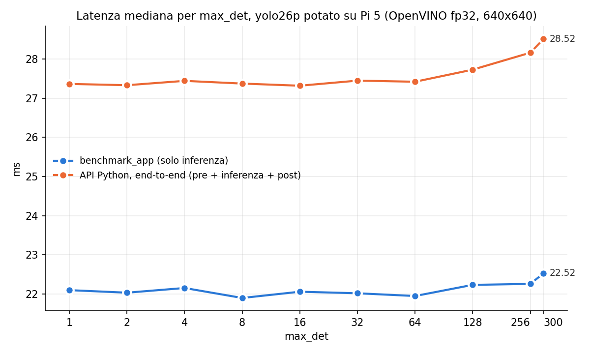
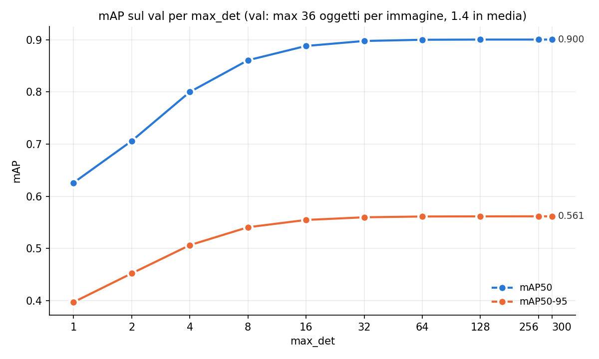

# Ablation: max_det sul Raspberry Pi 5

Latenza e mAP del yolo26p potato e finetunato (`experiments/rpi5_finetuned_musgd`) al variare di
`max_det`, il numero di box in uscita: nella testa one-to-one di YOLO26 e' il k del TopK,
fissato nel grafo all'export. Valori: 1, 2, 4, 8, 16, 32, 64, 128, 256 e 300 (default di
Ultralytics). Il val ha al massimo 36 oggetti per immagine, 1.4 in media.

- Un IR OpenVINO fp32 640x640 per valore, esportato come `src/backends/openvino.py`.
- mAP: `model.val()` dell'IR sul val intero (workstation, CPU, batch 1, conf 0.001), con
  `max_det` uguale a quello del grafo.
- Latenza sul Pi (2.4 GHz governor performance, 4 thread, FIFO 80, attesa termica fino a 50 °C):
  - `benchmark_app`: solo inferenza, due passate in ordine opposto da 300 iterazioni;
  - API Python di OpenVINO: pre-processing + inferenza + post-processing (conf 0.25) su 300
    frame del val gia' 640x640 in memoria (camera a 640), 3 giri alternati.
- Script: `run_experiment.py` (export, mAP, misure sul Pi con `bench.sh` e `pi_bench.py`,
  grafici), `--report` per i soli grafici. Dati in `results/`.

## Risultati

| max_det | benchmark_app (ms) | end-to-end API Python (ms) | box per frame (conf 0.25) | mAP50 | mAP50-95 |
|---|---|---|---|---|---|
| 1 | 22.09 | 27.37 | 0.94 | 0.626 | 0.397 |
| 2 | 22.03 | 27.33 | 1.17 | 0.706 | 0.452 |
| 4 | 22.15 | 27.45 | 1.29 | 0.800 | 0.506 |
| 8 | 21.89 | 27.38 | 1.36 | 0.861 | 0.541 |
| 16 | 22.05 | 27.32 | 1.38 | 0.888 | 0.555 |
| 32 | 22.02 | 27.45 | 1.38 | 0.898 | 0.560 |
| 64 | 21.95 | 27.42 | 1.38 | 0.900 | 0.561 |
| 128 | 22.23 | 27.73 | 1.38 | 0.900 | 0.561 |
| 256 | 22.26 | 28.17 | 1.38 | 0.900 | 0.561 |
| 300 | 22.52 | 28.52 | 1.38 | 0.900 | 0.561 |

- Latenza piatta fino a 64 (~22.0 ms con benchmark_app, ~27.4 ms end-to-end), poi sale: a 300
  +0.5 ms con benchmark_app e +1.1 ms end-to-end (-4%). Sotto 64 il TopK non costa nulla di
  misurabile; le differenze tra 1 e 64 sono rumore (~0.2 ms tra due passate).
- In deploy contano solo le box sopra la soglia (0.25 qui): da `max_det` 16 in su sono sempre
  le stesse (1.38 per frame); sotto si perdono oggetti nelle immagini affollate.
- La mAP serve solo da controllo: si calcola con conf 0.001, quindi usa anche le box poco
  sicure per la curva precision-recall, e satura solo verso 64 anche se il val ha al massimo
  36 oggetti per immagine. Con `max_det` basso la mAP sottostima il modello anche quando in uso
  le detection sarebbero le stesse.
- Temperatura 60-68 °C durante le misure.

## Conclusione

`max_det` taglia le box per punteggio prima della soglia di confidenza, quindi conta solo se
scarta box che la soglia avrebbe tenuto. L'ordine e':

1. si tara prima `conf`, sul punto di lavoro voluto (precision contro recall);
2. poi si tara `max_det`: almeno il numero massimo di box sopra quella soglia atteso in un
   frame reale, con margine. Piu' bassa e' la soglia, piu' box passano e piu' alto deve essere
   `max_det`.

Sotto quel valore si perdono oggetti; sopra non cambia niente nelle detection e costa solo
latenza (qui da 64 in su, fino a ~1 ms a 300). Per AOD4 con conf 0.25 basterebbe 16; 64 tiene
margine e non perde nulla nemmeno in mAP. La mAP fa eccezione: si calcola a conf 0.001, quindi
per riportarla serve un `max_det` alto (o il default 300).

