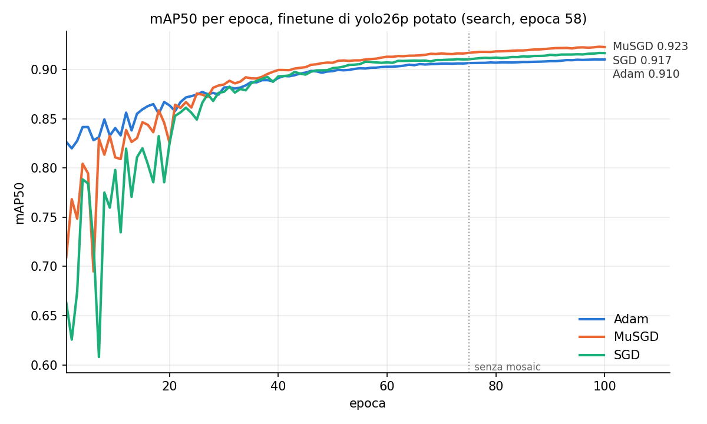
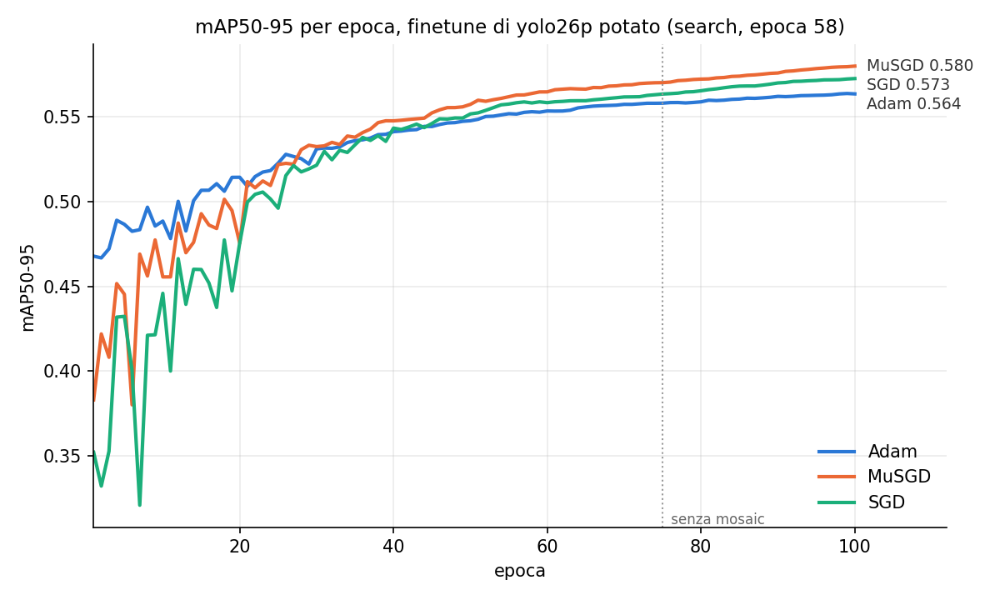

# Ablation: optimizer del finetune

Finetune di yolo26p potato con tre optimizer, stesso punto di partenza e stessi altri parametri
(100 epoche, batch 64, `close_mosaic` 25, stessa augmentation).

- Partenza: search `pit_duccio_pico` (N=8) interrotta, ultima epoca salvata (58): ops 48.7%,
  params 39.8%, mAP50 0.747.
- Script: `finetune_test.py <adam|musgd|sgd>`, grafici con `plot_finetune.py`.
- Configurazioni in `configs/`: la conf di yoloeval e gli argomenti completi di Ultralytics.

| optimizer | lr0 → lr0·lrf | mAP50 | mAP50-95 |
|---|---|---|---|
| MuSGD | 0.005 → 5e-5 | **0.923** | **0.580** |
| SGD | 0.01 → 1e-6 | 0.917 | 0.573 |
| Adam | 0.001 → 1e-5 | 0.910 | 0.564 |

Adam sale più regolare nelle prime ~25 epoche; da ~40 MuSGD resta davanti. Alla 100 le curve
salgono ancora.

