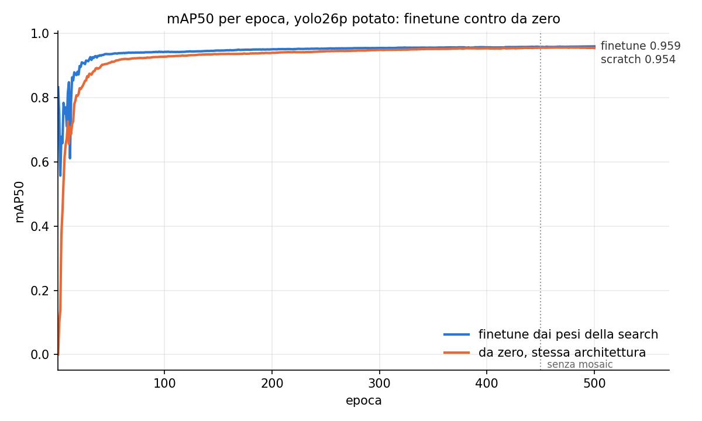
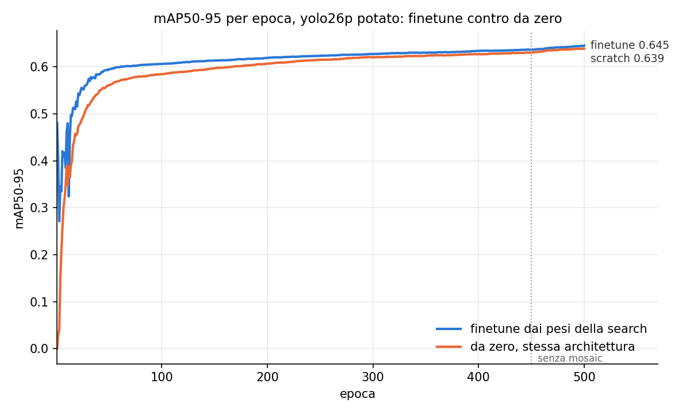

# Ablation: finetune contro training da zero sull'architettura potata

Stessa architettura potata, stessi parametri e stesso budget: cambia solo l'inizializzazione.
Serve a capire se conta l'architettura trovata dalla search o i pesi ereditati.

- Partenza: yolo26p MuSGD con 15 epoche in piu' senza mosaic (`experiments/scratch_musgd_close_mosaic`,
  epoca 263, 0.962 / 0.652), in cache con `+train.extra=close_mosaic15`.
- Search: `pit_duccio_pico` dalla pipeline (target 50% di MAC e params, margine 5%, 60 epoche,
  N=8 dal probe di rpi5 int8); `best.pt` = epoca con mAP50-95 migliore entro il budget.
- Due training dal `pruned.pt` della search, con `PrunedTrainer`:
  - **finetune**: pesi della search;
  - **scratch**: pesi reinizializzati (init di PyTorch, BN e bias della testa come Ultralytics).
- Parametri di `conf/train/scratch_musgd.yaml` per entrambi (MuSGD, lr0 0.01 → 1e-4, warmup 3),
  con 500 epoche e `close_mosaic` 50.
- Script: `run_experiment.py` (tutto), `--report` per i soli grafici. Log in
  `outputs/ablation_pruned/`, risultati in `finetune/` e `scratch/`, dati della search in
  `search.json`.

## Risultati

Search: epoca 60 (best), ops 50.2%, params 51.2% (entro il margine), mAP50 / mAP50-95 0.915 /
0.567 (dati in `search.json`).

| run | mAP50 | mAP50-95 | mAP50-95 a 50 / 100 / 200 / 300 / 450 epoche |
|---|---|---|---|
| finetune | **0.959** | **0.645** | 0.595 / 0.606 / 0.619 / 0.628 / 0.637 |
| scratch | 0.954 | 0.639 | 0.561 / 0.585 / 0.607 / 0.620 / 0.631 |

- Il finetune parte avanti (+0.034 alla 50) e resta davanti fino alla fine, ma il distacco si
  chiude: +0.021 alla 100, +0.006 alla 500. Conta soprattutto l'architettura: da zero si arriva
  quasi allo stesso punto, solo piu' lentamente.
- Entrambi salgono ancora alla 500; la chiusura del mosaic (450) aggiunge ~0.008 a tutti e due.
- Rispetto al non potato di partenza (0.962 / 0.652, 265 epoche): -0.003 di mAP50 e -0.007 di
  mAP50-95 con meta' delle MAC e dei parametri.
- Il finetune resta la scelta: arriva prima e un po' piu' in alto a parita' di budget.

