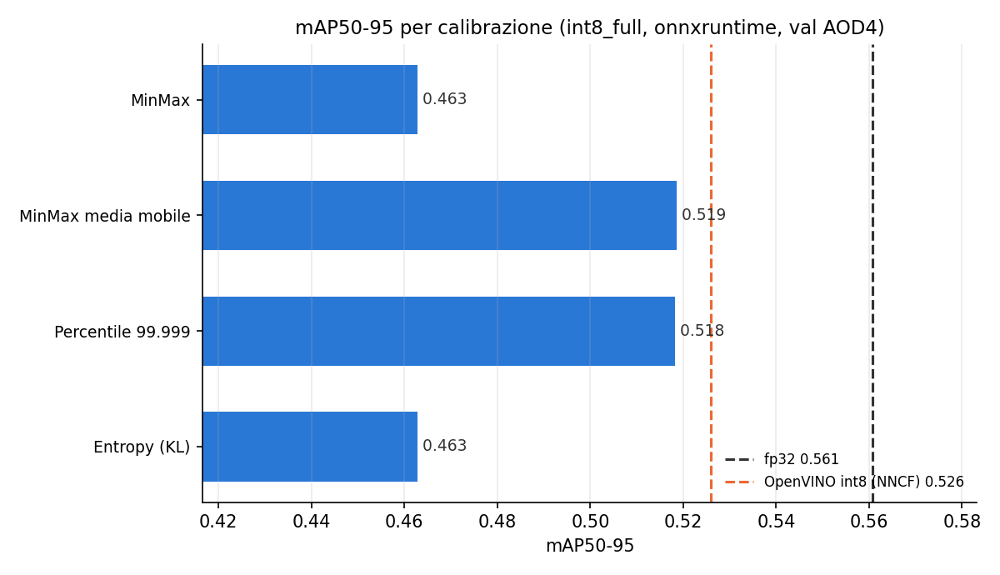
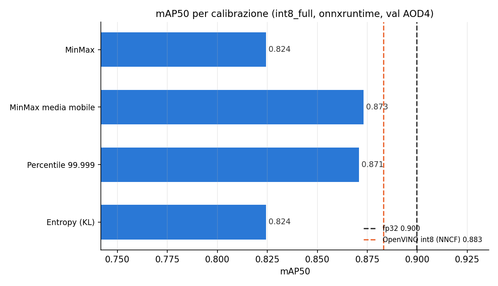

# Ablation: metodo di calibrazione dell'int8

Con `int8_full` (QDQ di onnxruntime, tutti i nodi in int8 tranne Softmax e coda della testa)
l'int8 e' veloce sul Pi (22.0 ms contro 28.0 di fp32, `experiments/rpi5_int8_backend`), ma
con la calibrazione MinMax globale perde 0.10 di mAP50-95; NNCF (OpenVINO) solo 0.035. Qui si
confrontano i metodi di calibrazione di onnxruntime sullo stesso grafo.

- Modello: yolo26p potato ep58 finetunato (`experiments/rpi5_finetuned_musgd`).
- Metodi (`conf/quantization/int8_full*.yaml`, parametri `calibration_method` e
  `calibration_options`): MinMax globale (`int8_full_minmax`, allora `int8_full`), MinMax con media mobile
  (`int8_full_ma`, la piu' vicina al MEAN_MINMAX di NNCF), Percentile 99.999
  (`int8_full_pct`), Entropy/KL (`int8_full_entropy`). Stesse 512 immagini di calibrazione.
- Solo accuratezza, sulla workstation: la calibrazione cambia le scale, non il grafo, quindi
  la latenza resta quella di int8_full. mAP con `model.val()` dell'ONNX su CPU, stesse soglie
  della mAP sul Pi (conf 0.001, iou 0.7, max_det 300). Riferimenti: fp32 e OpenVINO int8 (NNCF,
  misurato sul Pi).
- Script: `run_experiment.py`, `--report` per i soli grafici. Risultati in `results.json`.

## Risultati

| calibrazione | mAP50 | mAP50-95 | perdita mAP50-95 rispetto a fp32 |
|---|---|---|---|
| fp32 | 0.900 | 0.561 | – |
| MinMax (`int8_full_minmax`) | 0.824 | 0.463 | -0.098 |
| **MinMax media mobile** (`int8_full_ma`) | **0.873** | **0.519** | **-0.042** |
| Percentile 99.999 (`int8_full_pct`) | 0.871 | 0.518 | -0.043 |
| Entropy (`int8_full_entropy`) | 0.824 | 0.463 | -0.098 |
| riferimento: OpenVINO int8 (NNCF, sul Pi) | 0.883 | 0.526 | -0.035 |

- Ignorare gli outlier dimezza la perdita: media mobile e Percentile recuperano 0.056 di
  mAP50-95 rispetto al MinMax globale e arrivano a 0.007 da NNCF, con la latenza di int8_full
  (22.0 ms sul Pi, contro 22.4 di OpenVINO fp32 e 32.9 dell'int8 NNCF).
- Media mobile e Percentile si equivalgono; la media mobile costa molto meno (niente
  istogrammi: Percentile ed Entropy arrivano a ~47 GB di RAM con 512 immagini).
- Entropy coincide con MinMax (scale identiche, verificato): `quantize_static` di onnxruntime
  usa 128 bin e 128 bin quantizzati, non modificabili, quindi c'e' una sola soglia candidata.
  Per un vero Entropy serve un calibratore costruito a mano (es. 2048 bin come TensorRT).
- Dal 2026-10-02 la media mobile e' il default di `int8` e `int8_full` (onnxruntime e
  openvino_qdq); il MinMax globale resta in `int8_full_minmax`.
- La mAP calcolata qui coincide con quella sul Pi per fp32 e MinMax (0.561 e 0.463).

