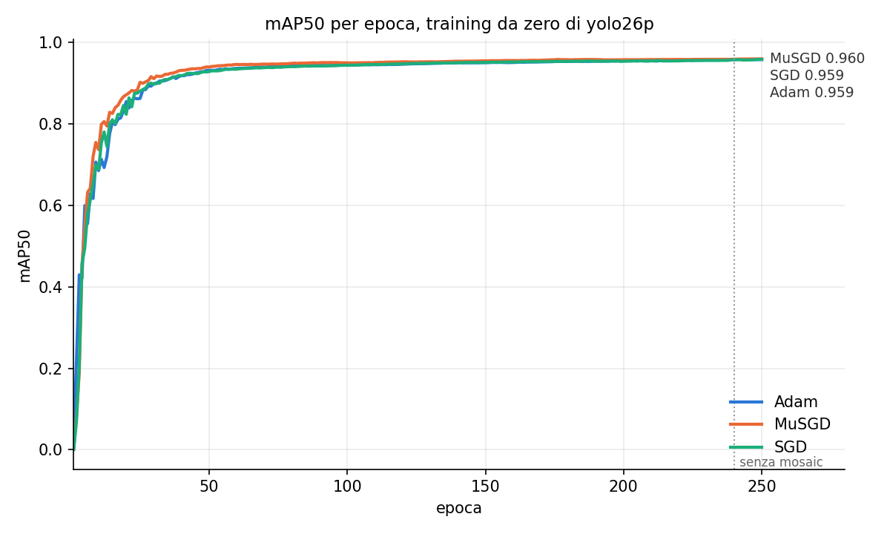
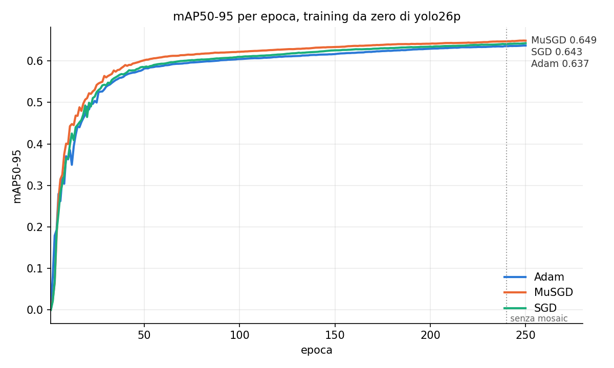

# Ablation: optimizer del training da zero

Training da zero di yolo26p su AOD4 con tre optimizer, stessi altri parametri (default di
Ultralytics): 250 epoche, batch 64, `lrf` 0.01, warmup 3, `close_mosaic` 10, niente early
stopping, stessa augmentation.

- Conf: `conf/train/scratch_{adam,musgd,sgd}.yaml`, copiate in `configs/` con gli argomenti
  completi di Ultralytics.
- Script: `train_ablation.py` lancia i tre training in parallelo con `run.py stage=train`
  (cache vera, `artifacts/weights/`), poi grafici e tabella; `--report` rifà solo questi.

| optimizer | lr0 → lr0·lrf | mAP50 | mAP50-95 |
|---|---|---|---|
| MuSGD | 0.01 → 1e-4 | **0.960** | **0.649** |
| SGD | 0.01 → 1e-4 | 0.959 | 0.643 |
| Adam | 0.001 → 1e-5 | 0.959 | 0.637 |

MuSGD e' davanti dalle prime epoche (0.542 di mAP50-95 alla 25, contro 0.525 di SGD e 0.500 di
Adam) e lo resta fino alla fine; sulla mAP50 dalla 100 i tre sono quasi alla pari. Alla 250 le
curve salgono ancora, poco: la chiusura del mosaic (240) aggiunge ~0.002. Il pico della tesi
(SGD, 1000 epoche, `close_mosaic` 100) arrivava a 0.960 / 0.662. Seguito:
`experiments/scratch_musgd_close_mosaic` (15 epoche in piu' senza mosaic su MuSGD).

