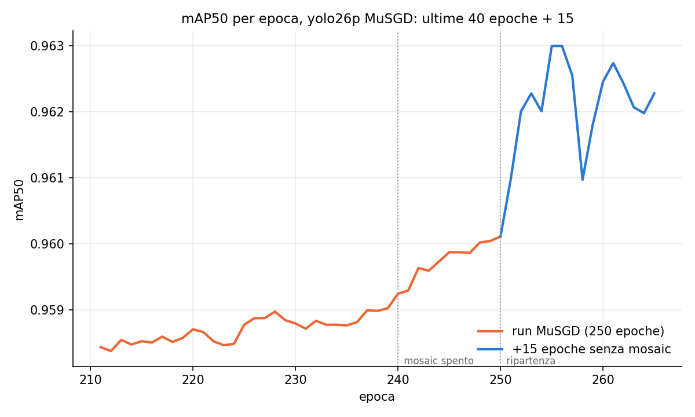
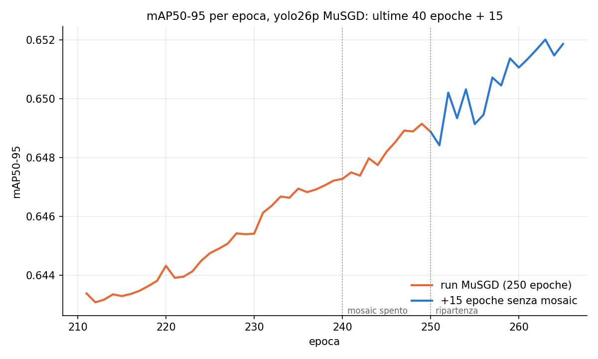

# yolo26p MuSGD: 15 epoche in piu' senza mosaic

Il training da zero con MuSGD (`train=scratch_musgd`, `experiments/ablation/train/lr_scheduler`)
ha `close_mosaic: 10` su 250 epoche; nella tesi il pico aveva 100 su 1000. Qui si aggiungono 15
epoche senza mosaic (25 in tutto, il 10% finale) per vedere se la mAP sale ancora.

- Partenza: `last.pt` all'epoca 250. Training nuovo di 15 epoche (a fine training last.pt non ha
  lo stato dell'optimizer, quindi niente resume): lr costante al valore finale del run
  (lr0 * lrf = 1e-4), niente warmup, mosaic spento, il resto come `scratch_musgd`.
- Fuori dalla cache: pesi e risultati in `run/`; il best.pt del training resta quello a 250.
- Le 15 epoche sono aggiunte a `results.csv` del run MuSGD come 251-265 (originale in
  `results_e250.csv`).
- Script: `run_experiment.py` (`--after PID` per partire a fine ablation, `--report` per i soli
  grafici).

## Risultati

| | epoca | mAP50 | mAP50-95 |
|---|---|---|---|
| fine run | 250 | 0.960 | 0.649 |
| +15 senza mosaic | 265 | **0.962** | **0.652** |

+0.002 di mAP50 e +0.003 di mAP50-95, con la curva ancora in leggera salita alla 265. La
mAP50-95 saliva gia' prima del mosaic spento (240): il guadagno non si separa da quello delle
epoche in piu' a lr basso. La tesi (1000 epoche, `close_mosaic` 100) arrivava a 0.662.

